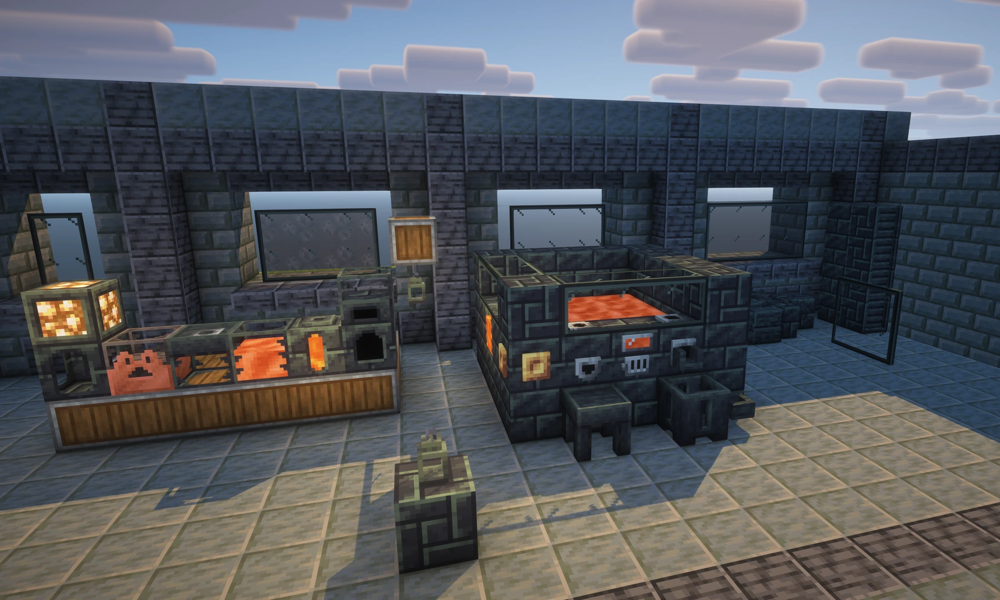
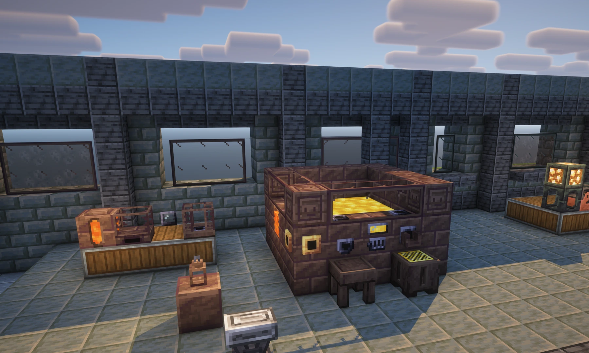

**English** · [简体中文](README.zh-CN.md)

# Create Style Foundry

Give the smeltery and foundry a Create-inspired look with cut stone bricks, dark framed glass, brass vents, and an industrial iron anvil pedestal. Carved scorched bricks retain their original relief with Create's scoria colors and grain.

## Compatibility and required mods

| Minecraft | Loader | Java | Required mods |
| --- | --- | --- | --- |
| 1.20.1 | Forge | 17 | [Create 6.0.8](https://github.com/Creators-of-Create/Create/releases/tag/mc1.20.1-6.0.8), [Tinkers' Construct 3.12.1](https://www.curseforge.com/minecraft/mc-mods/tinkers-construct), [Mantle](https://www.curseforge.com/minecraft/mc-mods/mantle) |
| 1.21.1 | NeoForge | 21 | [Create 6.0.10](https://github.com/Creators-of-Create/Create/releases/tag/mc1.21.1-6.0.10), [Modern Foundry 1.6.1](https://www.curseforge.com/minecraft/mc-mods/modern-foundry), [Hilt](https://modrinth.com/mod/hilt) |

The versions above are the targets for this release. The resource pack runs on the client and changes the appearance of blocks and items.

## Installation

1. Install the required mods for your Minecraft version.
2. Download the matching ZIP from the [release page](https://github.com/Eldershi/create-style-foundry/releases/tag/v1.0.0). Choose `forge-1.20.1` for Tinkers' Construct or `neoforge-1.21.1` for Modern Foundry.
3. In Minecraft, open **Options → Resource Packs → Open Pack Folder**. Put the ZIP in that folder and keep it zipped.
4. Return to Minecraft and enable **Create Style Foundry**. Move it above any other resource pack that changes the same blocks, then select **Done**.

See [asset credits](CREDITS.txt).
