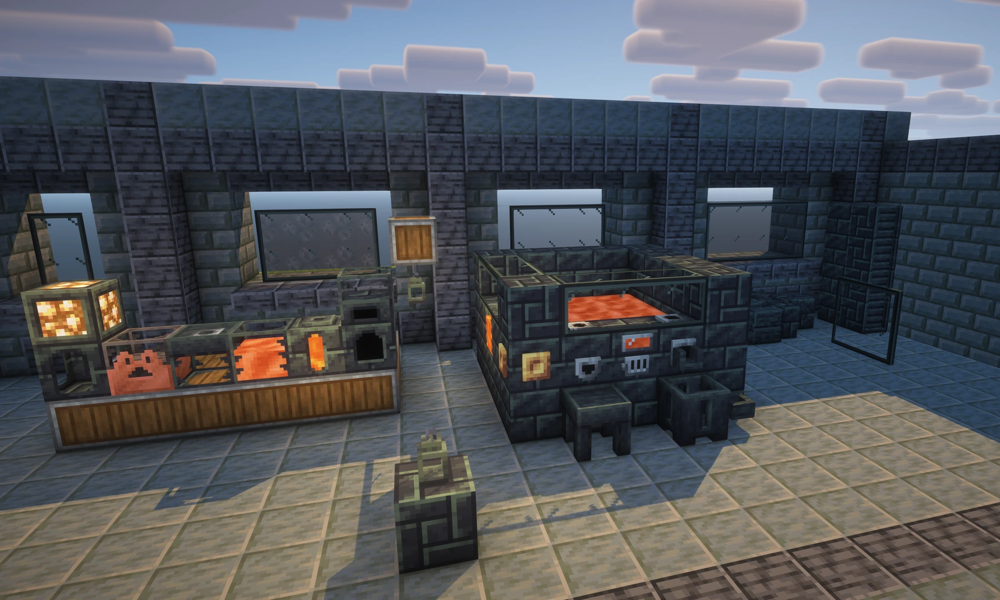
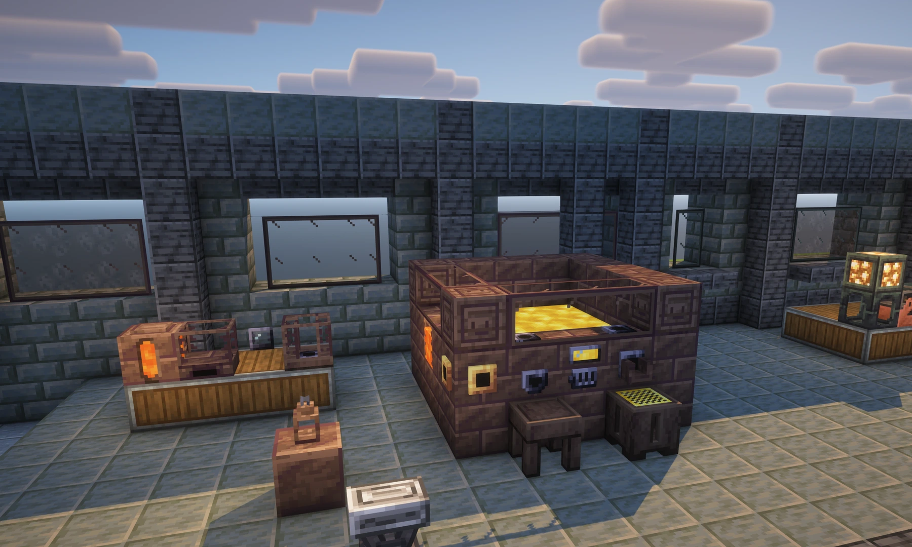

[English](README.md) · **简体中文**

# Create Style Foundry

给匠魂和高版本匠魂移植mod Modern Foundry 的冶炼炉、熔铸炉换上机械动力风格的熔渣材质。

## 兼容版本与前置模组

| Minecraft | 加载器 | Java | 匠魂 / Modern Foundry | 机械动力 | 前置库 |
| --- | --- | --- | --- | --- | --- |
| 1.20.1 | Forge | 17 | [匠魂 3.11.1–3.12.1](https://www.curseforge.com/minecraft/mc-mods/tinkers-construct/files/all) | [0.5.1.c–0.5.1.j、6.0.0–6.0.8](https://modrinth.com/mod/create/versions?g=1.20.1) | [Mantle](https://modrinth.com/mod/mantle) |
| 1.21.1 | NeoForge | 21 | Modern Foundry [1.0.0、1.5.0、1.6.0–1.6.1](https://modrinth.com/mod/hexa-tinkers-construct-unofficial-port/versions) 或 [4.0.1–4.1.8](https://github.com/Modern-Mods/ModernFoundry/releases) | [6.0.0–6.0.10](https://modrinth.com/mod/create/versions?g=1.21.1) | [Hilt](https://modrinth.com/mod/hilt) |

Mantle 是匠魂的前置库，Hilt 是 Modern Foundry 的前置库。按所选模组的要求安装对应的库版本即可。材质包在客户端生效。

匠魂 3.9.x 至 3.11.0 的部分浇铸设备使用较早的模型，外观覆盖有限。Modern Foundry 4.0.0 使用不同的资源 ID，需要单独适配。

## 安装方法

1. 给对应的 Minecraft 版本安装表中的前置模组。
2. 从[发布页](https://github.com/Eldershi/create-style-foundry/releases/latest)下载对应的 ZIP。匠魂选 `forge-1.20.1`，Modern Foundry 选 `neoforge-1.21.1`。
3. 在 Minecraft 里打开 **选项 → 资源包 → 打开包文件夹**，把 ZIP 原样放进去。
4. 回到 Minecraft，启用 **Create Style Foundry**。如果还有其他资源包会修改同样的方块，把本材质包移到那些资源包上方，再点**完成**。

参见[美术素材鸣谢](CREDITS.txt)。
